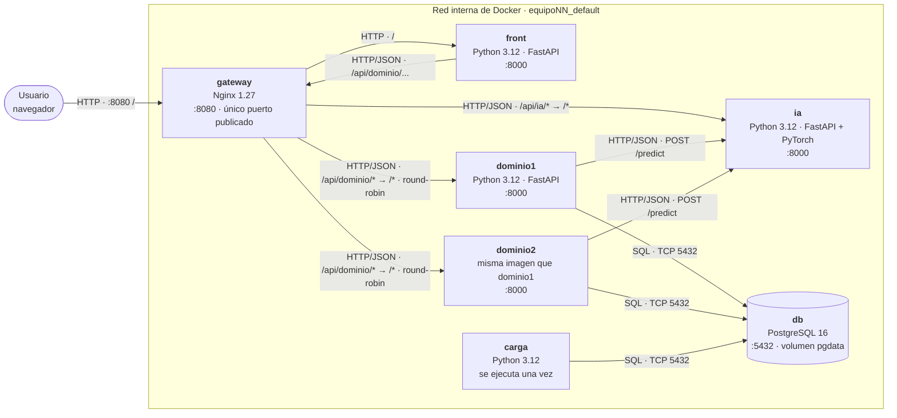

# 5.2 Nivel 2 · Contenedores

La figura 5.2 muestra los servicios del `compose.yaml` y cómo se comunican. Todos viven en la misma red interna de Docker y se encuentran por el nombre del servicio. Solo el gateway publica un puerto hacia fuera, el 8080.

*Figura 5.2. Vista de bloques de construcción, nivel 2: contenedores del sistema en Docker Compose.*

| Contenedor | Responsabilidad | Tecnología e imagen | Depende de |
|---|---|---|---|
| gateway | Única puerta de entrada: enruta `/` al front y `/api/...` a cada microservicio, y reparte entre las dos réplicas de dominio | `ghcr.io/franalarcon24/gateway:ep2` (Nginx 1.27 Alpine) | front, dominio1, dominio2, ia |
| front | Página donde se pide la probabilidad de compra de un cliente en una categoría y se ve su historial | `ghcr.io/ealejandro23/front:ep2` (Python 3.12 slim, FastAPI) | gateway |
| dominio1, dominio2 | Lógica de negocio: consulta usuarios, categorías e historial, pide la predicción a la IA y la guarda en la base | `ghcr.io/<cuenta>/dominio:ep2` (Python 3.12, FastAPI) | db, carga, ia |
| ia | Sirve la inferencia del modelo de propensión de compra, con `POST /predict` y `GET /health` | `ghcr.io/<cuenta>/ia:ep2` (Python 3.12, FastAPI, PyTorch) | ninguno |
| db | Guarda usuarios, productos, transacciones y cada predicción con su entrada, resultado, versión del modelo y fecha | `postgres:16-alpine` (imagen oficial), volumen `pgdata` | ninguno |
| carga | Carga en la base los datos tratados y termina; no duplica filas si corre dos veces | `ghcr.io/<cuenta>/carga:ep2` (Python 3.12) | db |

**Relación con el nivel 1 (5.1).** Esta primera versión implementa en contenedores locales los bloques B2 (db), B4 (dominio, ia y gateway) y B5 (front, que en EP2 reemplaza a la extensión del tema de Shopify para poder demostrar el flujo). En el despliegue objetivo de AWS (7.1), el gateway pasa a ser un Application Load Balancer y las réplicas de dominio, tareas de ECS repartidas en dos zonas de disponibilidad.
